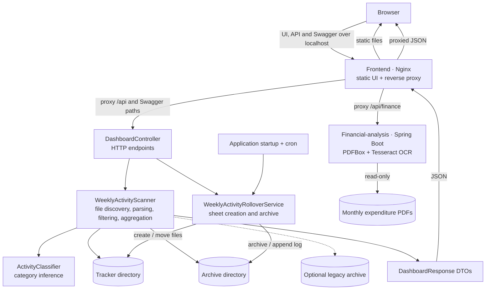

# Activity Dashboard — High-Level Design

## 1. Goals

- Present activity recorded in weekly Markdown files in a local browser dashboard.
- Summarize tasks, active days, explicit durations, and categories, with optional date filtering.
- Maintain one Monday–Sunday activity sheet per week and archive valid sheets from earlier weeks.
- Analyze month-organized expenditure PDFs locally and display recognized monthly totals by month.
- Keep activity data on local storage and expose the application only on host loopback.

## 2. Out of scope

- Cloud synchronization, shared/multi-user access, or remote integrations.
- Database-backed persistence or editing activity records from the dashboard.
- Inferred time tracking; only explicit duration annotations contribute to duration totals.

## 3. Component overview

### Responsibilities

| Component | Responsibility |
|---|---|
| Frontend (Nginx + `index.html`, `app.js`, `styles.css`) | Serve UI assets and proxy API, OpenAPI, and Swagger UI paths to the backend over the Compose network. |
| `DashboardController` | Expose health, dashboard, and manual rollover endpoints; translate invalid date ranges to HTTP 400 and I/O rollover failures to HTTP 500. |
| springdoc-openapi | Generate the OpenAPI description from Spring MVC endpoints and provide Swagger UI/OpenAPI resources through the backend. |
| `WeeklyActivityScanner` | Discover candidate weekly files, resolve duplicate filenames, validate week dates, parse completed-task bullets and annotations, filter dates, and calculate summary data. |
| `ActivityClassifier` / `ActivityCategory` | Infer a category from keywords when there is no valid explicit category annotation; define supported category labels. |
| Financial-analysis service | Discover month folders, extract embedded PDF text or run local OCR, and return recognized transactions and heuristic monthly totals. |
| `DashboardResponse` | Define the JSON result and nested summary/activity record shapes. |
| `WeeklyActivityRolloverService` | Ensure current-week sheet exists, preserve existing sheet, move valid earlier weekly sheets, and log rollover events/conflicts. |
| Spring startup listener and scheduler | Run rollover once after application startup and subsequently on the configured cron schedule. |
| Docker Compose | Build/run frontend and two backend containers; publish only frontend on loopback; mount tracker paths and financial PDFs read-only. |

## 4. Principal runtime flows

### Dashboard request

1. The browser loads static assets from the Nginx frontend.
2. The UI sends same-origin `GET /api/dashboard`, optionally including ISO `from` and `to` dates.
3. Nginx forwards the API request to the backend over the private Compose network.
4. The controller calls the scanner.
5. The scanner searches the source and configured archive directories for weekly Markdown files, validates and parses them, applies the requested date range, and aggregates the result.
6. Category inference is delegated to the classifier when the activity has no valid explicit category.
7. The controller serializes the response DTO as JSON. Nginx returns it to the browser, and the UI updates its summary cards, charts, table, and warnings.

### Weekly rollover

1. At application startup, the ready-event listener invokes the rollover operation to catch up if the service was stopped.
2. The Spring scheduler invokes the same operation according to the configured cron expression.
3. Rollover creates tracker/archive directories if missing.
4. It creates the current Monday–Sunday sheet only if it does not already exist.
5. It moves valid weekly sheets whose start date precedes the current week's Monday into the archive. Existing same-name archive copies are preserved and reported as conflicts.
6. It appends rollover events to `activity-tracker.log` in the archive directory and logs through the Java logger.
7. The manual `POST /api/rollover` endpoint invokes the same operation.

### Monthly financial analysis

1. The dashboard requests `GET /api/finance/months`; the service discovers years/months from the configured PDF folder.
2. The selected `yyyy-MM` is sent to `GET /api/finance?month=yyyy-MM`.
3. The financial-analysis service reads only that month's PDF files from its read-only bind mount. Filenames containing `Pani camper` or `Dudh Hisab` are excluded as duplicate content.
4. PDFBox extracts embedded text. If the PDF is scanned, local Tesseract OCR is attempted.
5. Date-associated rows and explicit income/expense totals are recognized with local rules, categorized heuristically, and returned with per-file extraction statuses and warnings. Unrecognized values remain unknown rather than being presented as zero.

## 5. Data and deployment

- **Input format:** UTF-8 Markdown file named `Week-dd.MM.yyyy-dd.MM.yyyy-Activity.md`, covering Monday through Sunday. Only top-level task bullets under a weekday's `### Completed` section count as activities.
- **Tracker path:** `Tracker-Docs` host directory configured by `TRACKER_SOURCE_HOST_PATH`, mounted as `/data/tracker`.
- **Archive path:** `Tracker-Docs/Activity-log` configured by `TRACKER_ARCHIVE_HOST_PATH`, mounted as `/data/archive`.
- **Financial documents path:** `Tracker-Docs/Monthly-Expenditure` configured by `FINANCIAL_DOCUMENTS_HOST_PATH`, mounted read-only as `/data/financial`.
- **Financial documents path:** host path configured by `FINANCIAL_DOCUMENTS_HOST_PATH`, mounted read-only as `/data/financial` in the financial-analysis service.
- **Optional legacy path:** `TRACKER_LEGACY_ARCHIVE_DIRECTORY` can provide a further read-only scan location; it is not set by default in Compose.
- **Host endpoint:** `http://127.0.0.1:${DASHBOARD_PORT:-8080}/`.
- **Frontend:** Nginx serves the dashboard on container port `80`; only this service is published on host loopback.
- **Backend:** Spring Boot listens on container port `8080` on the private Compose network; its port is not published to the host.
- **Financial-analysis backend:** Spring Boot listens on container port `8081` on the private Compose network; its port is not published to the host.
- **API documentation:** Swagger UI at `/swagger-ui.html`; OpenAPI JSON at `/v3/api-docs`, proxied by Nginx to Spring Boot.
- **Build/runtime:** Maven 3.9.9 + Java 17 build image and Java 17 JRE runtime image.
- **Timezone/schedule:** Asia/Kolkata; default rollover schedule is 12:05 AM daily.
- **Persistence:** Plain files on bind-mounted host directories; no database.

## 6. Design decisions and constraints

- Separate static UI delivery from API and file-processing logic into frontend and backend Compose services.
- Use plain Markdown as the durable user-owned source of truth.
- Derive totals on request rather than maintaining a separate index that could become stale.
- Restrict host network publication to loopback. There is no authentication mechanism, so the service is intended for a trusted local machine.
- Keep scanning read-only; isolate document changes to rollover operations.
- Keep financial PDFs read-only and local. OCR and transaction/category recognition are heuristic and require verification against the source documents.
- Durations remain unknown unless explicitly recorded. Categories are heuristic unless a recognized annotation is present.
- If tracker input is unavailable or unreadable, the dashboard reports a service error rather than returning a success-shaped empty result.

## 7. Operational and failure behavior

- `restart: unless-stopped` restarts either container after failures unless an operator has stopped it.
- Startup rollover provides catch-up after downtime; the daily scheduled operation maintains the weekly file thereafter.
- Invalid or malformed weekly filenames and annotations may produce dashboard warnings and are excluded or interpreted according to scanner rules.
- An archive naming conflict leaves both copies untouched and logs a warning.
- Container logs are available through `docker compose logs`; rollover also appends to `activity-tracker.log`.
