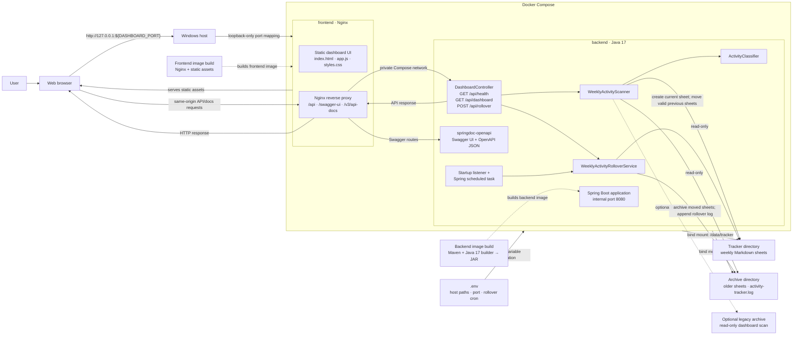

# Activity Dashboard Architecture

## Purpose and scope

The Activity Dashboard is a local frontend/backend application for viewing personal activity recorded in weekly Markdown files. The frontend serves the browser UI and proxies HTTP API/documentation requests to the backend. The backend scans configured tracker/archive directories and creates/archives weekly sheets. It does not integrate with hosted services or use a database.

## System context

## Service integrations

| Integration | Direction and protocol | Purpose |
|---|---|---|
| Browser to frontend | HTTP on `127.0.0.1`, default host port `8080` | Loads static UI and sends same-origin API/Swagger requests. Docker Compose publishes only the frontend on host loopback. |
| Frontend to backend | HTTP over the private Docker Compose network | Nginx forwards API, OpenAPI, and Swagger UI requests to the Spring Boot backend on port `8080`. |
| Tracker host directory | Docker bind mount to `/data/tracker`; local filesystem | Read weekly Markdown sheets; create the current week sheet; move valid earlier weeks to the archive. |
| Archive host directory | Docker bind mount to `/data/archive`; local filesystem | Scan archived sheets; receive archived weekly sheets; store `activity-tracker.log`. |
| Optional legacy archive | Configured filesystem path, outside the default Compose mounts | Additional read-only source for dashboard scans. It is not configured by the supplied Compose file. |
| Docker Compose | Environment variables, port mapping, bind mounts, container lifecycle | Builds/runs the service, supplies paths and rollover schedule, and restarts the container unless stopped. |
| Maven/Java container images | Build-time image layers | Maven and Java 17 compile/package the Spring Boot JAR; the runtime image executes it. |

There is no database, message broker, authentication provider, or external HTTP/API integration.

## Runtime and deployment

Docker Compose runs two services on its private network: Nginx `frontend` and Spring Boot `backend`. The backend image uses a multi-stage build: Maven 3.9.9 with Java 17 packages the application, then a Java 17 JRE image runs the JAR. The backend binds to container interfaces but has no host-published port. The frontend publishes container port `80` to the configured host port on loopback only.

Compose maps the host tracker and archive directories to the backend at `/data/tracker` and `/data/archive`, and configures it to use Asia/Kolkata time. The rollover schedule defaults to `0 5 0 * * *` (12:05 AM daily). Both the container timezone and Java timezone are configured. Both services use `restart: unless-stopped`.

## Key trust and data boundaries

- Activity content remains in the user's selected local folders and is not sent to a remote service.
- Dashboard scanning reads the tracker/archive inputs and does not modify them.
- Rollover is the only normal operation that creates or moves tracker documents; it writes its operational log in the archive directory.
- The frontend is intended for local use and is bound to host loopback by Compose; the backend is not published to the host. No authentication layer is configured.
- The `.env` file contains host path configuration and should not be shared if those paths disclose private user information.
