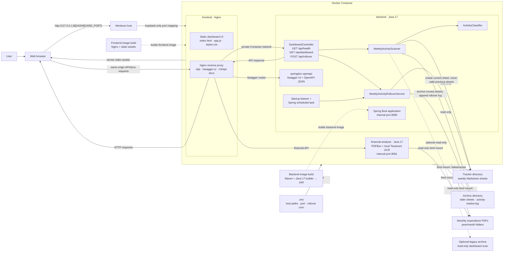

# Activity Dashboard Architecture

## Purpose and scope

The Activity Dashboard is a local frontend and two-backend application for viewing weekly Markdown activity and monthly financial summaries. The frontend serves the browser UI and proxies requests to the activity and financial-analysis services. The activity backend scans configured tracker/archive directories and creates/archives weekly sheets. The financial service reads month-organized PDFs read-only, extracts text locally (including OCR for scanned files), and returns heuristic summaries. It does not integrate with hosted services or use a database.

## System context

## Service integrations

| Integration | Direction and protocol | Purpose |
|---|---|---|
| Browser to frontend | HTTP on `127.0.0.1`, default host port `8080` | Loads static UI and sends same-origin API/Swagger requests. Docker Compose publishes only the frontend on host loopback. |
| Frontend to backend | HTTP over the private Docker Compose network | Nginx forwards API, OpenAPI, and Swagger UI requests to the Spring Boot backend on port `8080`. |
| Frontend to financial-analysis | HTTP over the private Docker Compose network | Nginx forwards `/api/finance` requests to the financial service on port `8081`. |
| Tracker host directory | Docker bind mount to `/data/tracker`; local filesystem | Read weekly Markdown sheets; create the current week sheet; move valid earlier weeks to the archive. |
| Archive host directory | Docker bind mount to `/data/archive`; local filesystem | Scan archived sheets; receive archived weekly sheets; store `activity-tracker.log`. |
| Monthly expenditure directory | Read-only Docker bind mount to `/data/financial`; local filesystem | Read year/month-organized PDFs for the selected month. PDFs are never modified. |
| Financial-analysis service | HTTP over private Compose network on port `8081` | Discover PDF months, extract text/OCR locally, recognize transaction rows, and return heuristic summaries. |
| Optional legacy archive | Configured filesystem path, outside the default Compose mounts | Additional read-only source for dashboard scans. It is not configured by the supplied Compose file. |
| Docker Compose | Environment variables, port mapping, bind mounts, container lifecycle | Builds/runs the service, supplies paths and rollover schedule, and restarts the container unless stopped. |
| Maven/Java container images | Build-time image layers | Maven and Java 17 compile/package the Spring Boot JAR; the runtime image executes it. |

There is no database, message broker, authentication provider, or external HTTP/API integration. Financial PDFs whose filenames contain `Pani camper` or `Dudh Hisab` are excluded as duplicate content.

## Runtime and deployment

Docker Compose runs three services on its private network: Nginx `frontend`, Spring Boot `backend`, and Spring Boot `financial-analysis`. The Java services use multi-stage Maven 3.9.9/Java 17 builds and Java 17 JRE runtime images. Tesseract OCR is installed only in the financial-analysis runtime and runs locally. Neither backend has a host-published port. The frontend publishes container port `80` to the configured host port on loopback only.

Compose maps the host tracker and archive directories to the activity backend at `/data/tracker` and `/data/archive`, and maps `Monthly-Expenditure` read-only to the financial service at `/data/financial`. The activity backend uses Asia/Kolkata time. The rollover schedule defaults to `0 5 0 * * *` (12:05 AM daily). Containers use `restart: unless-stopped`.

## Key trust and data boundaries

- Activity content and financial PDFs remain in the user's selected local folders and are not sent to a remote service.
- Dashboard scanning reads the tracker/archive inputs and does not modify them.
- Rollover is the only normal operation that creates or moves tracker documents; it writes its operational log in the archive directory.
- Financial PDFs are mounted read-only. OCR and heuristic parsing run inside the local container; document text is not logged or returned wholesale.
- The frontend is intended for local use and is bound to host loopback by Compose; the backend is not published to the host. No authentication layer is configured.
- PDF extraction and OCR are heuristic. Unreadable PDFs or unrecognized transaction rows are reported for manual review; unknown totals are not treated as zero.
- The `.env` file contains host path configuration and should not be shared if those paths disclose private user information.
